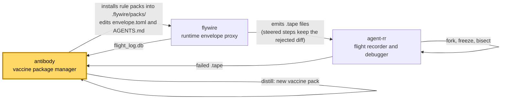
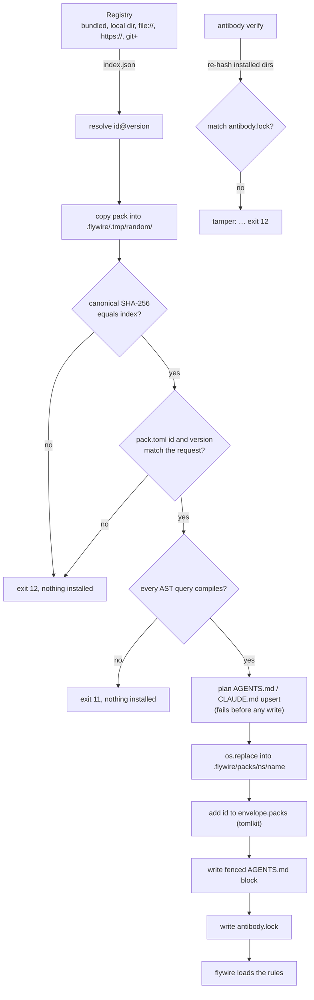
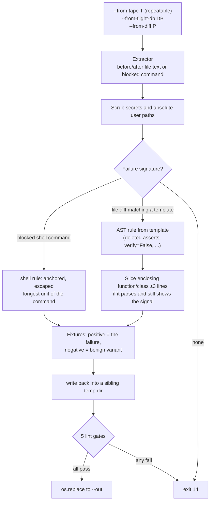
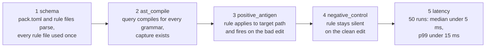

# antibody

A package manager for coding-agent failure modes: install "vaccines" (declarative rules, each proven against a fixture that reproduces the failure and one that must stay clean) into your repo, pin them with a SHA-256 lockfile, and distill new ones from failed agent runs.


[](https://github.com/harish-nair-ai/antibody/actions/workflows/ci.yml)

---

## Contents

- [The problem](#the-problem)
- [The idea: an immune system for your repo](#the-idea-an-immune-system-for-your-repo)
- [How it fits with flywire and agent-rr](#how-it-fits-with-flywire-and-agent-rr)
- [Architecture](#architecture)
- [Install](#install)
- [Quickstart](#quickstart)
- [Usage guide](#usage-guide)
- [Pack format reference](#pack-format-reference)
- [Exit codes](#exit-codes)
- [How it works and design decisions](#how-it-works-and-design-decisions)
- [Starter vaccines](#starter-vaccines)
- [Limitations and roadmap](#limitations-and-roadmap)
- [Development](#development)
- [Contributing](#contributing)
- [License](#license)

---

## The problem

Every team that uses coding agents ends up rediscovering the same failures:

- The agent deletes assertions in `tests/` to make a failing test pass.
- It adds `verify=False` to get past a certificate error, or `shell=True` to make a command work.
- It silences the type checker with `# type: ignore`, or the TypeScript compiler with `@ts-ignore`.
- It adds `.skip` to a failing Jest test, or leaves an empty `catch {}`.
- It runs `git push --force origin main` or `git reset --hard` to "clean up".

The usual response is a line in `AGENTS.md` and maybe a custom lint rule. Each team writes its own, nobody knows whether the rule actually catches the failure (or flags every harmless edit), and when an agent finds a new way to cheat, the lesson stays in one person's head.

## The idea: an immune system for your repo

An immune system learns from an infection once and then recognizes it everywhere. antibody packages a known failure mode the same way:

- The **antigen** is a minimal before/after fixture that reproduces the failure (for example a test file before and after its assertions were deleted).
- The **antibody** is a declarative rule (a tree-sitter query or a shell regex) that [flywire](https://github.com/harish-nair-ai/flywire) enforces at runtime, plus an optional line for `AGENTS.md`.
- A **vaccine** is the pair. A vaccine is only valid if its rule fires on the positive antigen **and** stays silent on a negative control (a harmless edit to the same kind of file). `antibody lint` checks both, plus a latency budget.
- A **pack** is a versioned set of vaccines (`core/python-safety`). Packs live in a registry, which is just a directory or static Git repo with an `index.json`.

Then: `antibody pull core/python-safety` vaccinates a repository, `antibody.lock` pins exactly what was installed, and `antibody distill` turns a new failure captured in an agent-rr tape into a new vaccine.

Pulling a pack never executes code from it. Installed rules are TOML and Markdown only.

## How it fits with flywire and agent-rr

antibody is one of three packages that share file formats (see [`CONTRACTS.md`](CONTRACTS.md)) and no Python code.



- antibody writes packs to `.flywire/packs/<namespace>/<name>/` and adds the pack id to `envelope.packs` in `envelope.toml`. [flywire](https://github.com/harish-nair-ai/flywire) loads the rules from there on its next start.
- When flywire blocks a call, the rejected diff ends up in its `flight_log.db` and (with `emit_tape = true`) in a `.tape`. [agent-rr](https://github.com/harish-nair-ai/agent-rr) records tapes too.
- `antibody distill` reads either one and produces a new pack that passes the same lint gates as the starter packs.

Without flywire, packs still give you tested `AGENTS.md` instructions and rules you can run in your own tooling, but nothing enforces them at runtime.

## Architecture

### Consume flow: `pull`, `sync`, `verify`



`.flywire/.tmp/` is always cleaned up in a `finally` block, whether the install succeeded or not.

### Produce flow: `distill`, `lint`, `test`



The five gates, run in order per vaccine (a later gate is skipped if an earlier one fails):



### Module map

| File | Responsibility |
|---|---|
| `src/antibody/cli.py` | Typer CLI: `search`, `pull`, `remove`, `sync`, `verify`, `lint`, `test`, `distill`. |
| `src/antibody/models.py` | Frozen pydantic v2 models: rules, `pack.toml`, `index.json`, `antibody.lock`. |
| `src/antibody/errors.py` | Error types carrying the documented exit codes. |
| `src/antibody/loaders.py` | Parses pack files; traversal-safe pack paths; one-rule-per-file check. |
| `src/antibody/fsutil.py` | Atomic writes, `resolve_inside` traversal check, workspace root discovery, directory swap. |
| `src/antibody/ast_engine.py` | AST rule semantics, identical to flywire's: cached grammars/queries, pre/post capture counts, parse-error skip. |
| `src/antibody/shell_engine.py` | Shell rule semantics, identical to flywire's `shell_units()`. |
| `src/antibody/registry/client.py` | Registry sources (bundled, dir, `file://`, `https://`, `git+`), XDG cache mirror, offline fallback. |
| `src/antibody/registry/hasher.py` | Canonical tree SHA-256. |
| `src/antibody/registry/index_builder.py` | Builds `index.json` from `<registry>/packs/*/*/`. |
| `src/antibody/registry/lockfile.py` | Reads, writes and verifies `antibody.lock`. |
| `src/antibody/installer/pack_installer.py` | Staged, hash-checked, atomic `pull`, `remove`, `sync`. |
| `src/antibody/installer/envelope_sync.py` | Adds/removes ids in `envelope.packs`, preserving comments (tomlkit). |
| `src/antibody/installer/agents_md_sync.py` | Fenced, idempotent upsert/remove of pack blocks in `AGENTS.md` and `CLAUDE.md`. |
| `src/antibody/validator/linter.py` | The 5 gates. |
| `src/antibody/validator/runner.py` | Fixture evaluation, latency measurement, isolated `pytest` run for pack evals. |
| `src/antibody/distiller/extractor.py` | Failures from tapes, flight logs and diffs; scrubbing; AST fixture slicing. |
| `src/antibody/distiller/templates.py` | The 8 deterministic failure signatures and the rule each one becomes. |
| `src/antibody/distiller/scaffolder.py` | Writes a complete draft pack, lints it in staging, moves it into place. |
| `src/antibody/starter_registry/` | Bundled registry: `index.json` and the 3 starter packs (18 vaccines). |

## Install

Python 3.11+. `git` is needed only for `git+` registries and for reading file contents during `distill`.

```bash
uv tool install git+https://github.com/harish-nair-ai/antibody
# or
pip install git+https://github.com/harish-nair-ai/antibody

antibody --version     # antibody 0.1.0
```

The starter registry ships inside the package, so `antibody search` and `antibody pull core/...` work offline.

## Quickstart

Run as shown, in a fresh git repository. flywire is used in steps 4 and 6 to show the rules being enforced; it is optional for everything else.

**1. Find and install packs**

```bash
$ antibody search
core/git-hygiene  0.1.0  5 rules  [shell]  Blocks force-pushes to main, skipped hooks, hard resets, destructive rm, and curl-pipe-sh.
core/python-safety  0.1.0  7 rules  [python]  Blocks test weakening, insecure defaults, and silent exception swallowing.
core/typescript-safety  0.1.0  6 rules  [typescript,tsx]  Blocks deleted/skipped tests, compiler suppressions, `any`, XSS sinks, and empty catches.

$ antibody pull core/python-safety --patch-agents-md
installed core/python-safety@0.1.0 -> .flywire/packs/core/python-safety
patched AGENTS.md
$ antibody pull core/git-hygiene
installed core/git-hygiene@0.1.0 -> .flywire/packs/core/git-hygiene
$ antibody verify
ok: 2 pack(s) match antibody.lock
```

**2. What changed in the repo**

`AGENTS.md`:

```markdown
<!-- antibody:start pack="core/python-safety" version="0.1.0" -->
- Never delete or comment out assertions in `tests/` to make CI pass.
- Never pass `verify=False` to HTTP clients or `shell=True` to subprocess calls.
- Never swallow exceptions with `except ...: pass`; handle, log, or re-raise them.
- Never add `# noqa` or `# type: ignore` to silence tools; fix the underlying error.
- Never build SQL with f-strings; use parameterized queries.
- Never introduce `eval()` or `exec()`; parse data explicitly.
<!-- antibody:end pack="core/python-safety" -->
```

`antibody.lock`:

```toml
schema_version = "0.1"
registry_url = "bundled://starter_registry"

[[installed]]
id = "core/git-hygiene"
version = "0.1.0"
sha256 = "b4d6337c0a430045acffbceddccbb0accdd23a0dd60109ff70bb65723016a935"
install_path = ".flywire/packs/core/git-hygiene"
agents_md_patched = false

[[installed]]
id = "core/python-safety"
version = "0.1.0"
sha256 = "e093250fd149949bb21e6caed09fb15d0c719c20203a4907b9214fe525e4d9ab"
install_path = ".flywire/packs/core/python-safety"
agents_md_patched = true
```

`envelope.toml` now lists both ids under `[envelope] packs`. Running the same `pull` again leaves every file byte-identical. Commit `.flywire/packs/`, `antibody.lock`, `envelope.toml` and `AGENTS.md`.

**3. Tampering is detected**

```bash
$ echo "# x" >> .flywire/packs/core/git-hygiene/patches/agents_md.md
$ antibody verify
tamper: core/git-hygiene: sha256 drift (locked b4d6337c…, found 72f86c1f…)
error: 1 pack(s) drifted from antibody.lock
$ echo $?
12
$ antibody sync
synced 2 pack(s); reinstalled 1
$ antibody verify
ok: 2 pack(s) match antibody.lock
```

**4. flywire enforces the packs**

```bash
$ flywire status
…
rules: 12 AST, 6 shell (18 total)
packs: core/python-safety (loaded), core/git-hygiene (loaded)
```

(10 AST rules are flywire built-ins; the pack adds `py-no-sql-fstring` and `py-no-eval-exec` and overrides the rest by id.) In a flywire session with `emit_tape = true`, an agent's attempt to delete the assertions in `tests/test_calc.py` was steered and recorded as a `steered` step holding the rejected diff, and `curl … | sh` was hard-blocked.

**5. Distill the failure into a new vaccine**

```bash
$ antibody distill --from-tape .flywire/tapes/<session>.tape --out vaccines/assert-guard
PASS schema pack
PASS schema distilled-py-deleted-assertions-a886f404
PASS ast_compile distilled-py-deleted-assertions-a886f404
PASS positive_antigen distilled-py-deleted-assertions-a886f404  expected violation, got violation
PASS negative_control distilled-py-deleted-assertions-a886f404  expected allow, got allow
PASS latency distilled-py-deleted-assertions-a886f404  median 0.037 ms, p99 0.049 ms
draft pack vaccines/assert-guard passes all 5 gates
```

`--step 2` picks the blocked shell command instead:

```bash
$ antibody distill --from-tape .flywire/tapes/<session>.tape --step 2 --out vaccines/no-curl-sh
…
draft pack vaccines/no-curl-sh passes all 5 gates
$ cat vaccines/no-curl-sh/rules/*.toml
[[shell_rules]]
id = "distilled-shell-5c35fc8b"
pattern = "^curl\\ \\-fsSL\\ https://example\\.com/install\\.sh\\ \\|\\ sh(?:\\s|$)"
severity = "hard_block"
message = "Blocked command recurred: curl -fsSL https://example.com/install.sh | sh"
remediation = "Do not re-run a command that was already blocked; find a safe alternative."
```

A diff file works too: `antibody distill --from-diff bad.diff --out vaccines/tls` on a diff that adds `requests.get(url, verify=False)` produced `distilled-py-ssl-verify-false-357eb53e`, also passing all gates.

**6. Publish it and install it like any other pack**

There is no `antibody publish` command yet; a registry is a directory with `packs/<ns>/<name>/` and an `index.json` you build with the Python API:

```bash
mkdir -p registry/packs/community
cp -R vaccines/no-curl-sh registry/packs/community/distilled-shell-5c35fc8b
python -c "
from pathlib import Path
from antibody.registry.index_builder import build_index, write_index
r = Path('registry'); write_index(r, build_index(r, '2026-11-24T00:00:00Z'))"

$ antibody search --registry registry
community/distilled-shell-5c35fc8b  0.1.0  1 rules  [shell]  Distilled: blocks a shell command that an agent was already stopped from running.
$ antibody pull community/distilled-shell-5c35fc8b --registry registry
installed community/distilled-shell-5c35fc8b@0.1.0 -> .flywire/packs/community/distilled-shell-5c35fc8b
$ flywire status
…
rules: 12 AST, 7 shell (19 total)
```

The pack directory name must equal `<name>` from its `pack.toml`, because `pull` checks that the installed manifest matches the requested id.

## Usage guide

Commands that touch the workspace find its root by walking up from the current directory to the first directory containing `envelope.toml` or `.git`.

The registry is chosen by `--registry`, else `$ANTIBODY_REGISTRY`, else `bundled://starter_registry` (for `sync`: `--registry`, else `$ANTIBODY_REGISTRY`, else the `registry_url` in `antibody.lock`).

### `antibody search [QUERY] [--lang L] [--registry R]`

Lists packs whose id or description contains `QUERY` (case-insensitive), optionally only those whose languages include `L` (`python`, `typescript`, `tsx`, `shell`).

### `antibody pull NS/NAME[@X.Y.Z] [--patch-agents-md] [--registry R]`

Installs the latest (or the given) version: stage in `.flywire/.tmp/`, verify the hash and identity, compile the queries, move into `.flywire/packs/NS/NAME`, add the id to `envelope.packs` (creating a minimal `envelope.toml` if there is none), update `antibody.lock`. With `--patch-agents-md`, the pack's `patches/agents_md.md` is written into a fenced block in `AGENTS.md` (created if absent) and in `CLAUDE.md` if that file already exists. Once a pack was pulled with `--patch-agents-md`, later pulls of the same pack keep the block updated.

### `antibody remove NS/NAME`

Deletes the installed directory, the id from `envelope.packs`, the `AGENTS.md`/`CLAUDE.md` block (and the blank line it added), and the lock entry. Exit 2 if the pack is not installed.

### `antibody sync [--registry R]`

Reinstalls every lock entry whose installed directory is missing or does not match its pinned hash, using exactly the pinned version. If the registry now serves different bytes for that version, sync refuses (exit 12) rather than silently installing them. Use it after cloning a repo or after `verify` reports drift.

### `antibody verify`

Re-hashes every installed pack and compares with `antibody.lock`. Prints one `tamper:` line per problem (drift, missing directory, path outside the root, symlink in a pack). Exit 12 on any problem. Suitable as a CI step.

### `antibody lint PACK_DIR`

Runs the 5 gates and prints one `PASS`/`FAIL` line per gate and vaccine. Exit 11 if anything fails. Never runs pack Python code.

### `antibody test [PACK_DIR]`

Runs the 5 gates and then the pack's own `evals/test_*.py` with `python -m pytest`, in a subprocess isolated from your project's pytest config (`-c /dev/null`, its own rootdir, no cache, no bytecode). Without `PACK_DIR`, tests every installed pack from the lockfile. Exit 11 on any gate or eval failure; the error line names each failing pack and gate (or failing eval test, or the reason pytest could not run). `pytest` is a runtime dependency, so this works in a plain `uv tool install` / `pip install`. This is the only command that executes code from a pack.

### `antibody distill (--from-tape T... | --from-flight-db DB | --from-diff P) --out DIR [--step N]`

Builds a draft pack from the first distillable failure, lints it in a staging directory and moves it to `DIR` only if all 5 gates pass. Exactly one source is required; `--from-tape` can be repeated; `--step` restricts a tape or flight log to one step. `DIR` must not exist or must be empty.

- **Tapes** (agent-rr or flywire): every step's diff is examined; the full before-image comes from `git show <pre_tree_sha>:<path>` when the recording repo is available, else it is rebuilt from the hunks. Steered steps with a shell command and no diff yield a blocked command.
- **Flight logs**: every `tool_events` row with a non-ALLOW verdict; file edits are reconstructed from the logged arguments against the current file.
- **Diffs**: a unified diff relative to `HEAD` of the workspace.

Signatures recognized (in this order): Python deleted assertions, `verify=False`, `shell=True`, `except: pass`, `# noqa` / `# type: ignore`, hardcoded `MOCK_` return values, TypeScript deleted `expect()`, `@ts-ignore`/`@ts-nocheck`; and blocked shell commands. Generated rule ids are `distilled-<signature>-<8 hex>`, with namespace `community` and version `0.1.0`. Exit 14 if nothing distillable is found or the draft fails a gate (nothing is written).

## Pack format reference

### Layout

```
core/python-safety/
├── pack.toml
├── rules/
│   ├── py_no_deleted_assertions.toml       # exactly one rule per file, named after the id (- → _)
│   └── ...
├── patches/
│   └── agents_md.md                        # optional: Markdown lines for AGENTS.md
└── evals/
    ├── test_vaccines.py                    # optional: run only by `antibody test`
    └── fixtures/
        ├── py-no-deleted-assertions/       # AST vaccine: suffix comes from target_sample_path
        │   ├── positive_before.py
        │   ├── positive_after.py           # the failure: the rule MUST fire
        │   ├── negative_before.py
        │   └── negative_after.py           # a clean edit: the rule MUST NOT fire
        └── sh-no-force-push/               # shell vaccine
            ├── positive.sh                 # whole file (stripped) is one command: MUST fire
            └── negative.sh                 # MUST NOT fire
```

### `pack.toml`

```toml
[pack]
namespace = "core"                     # ^[a-z0-9][a-z0-9-]*$
name = "python-safety"                 # same pattern; the id is namespace/name
version = "0.1.0"                      # X.Y.Z
description = "Blocks test weakening, insecure defaults, and silent exception swallowing."
authors = ["flywire-maintainers"]
license = "MIT"
languages = ["python"]                 # any of python, typescript, tsx, shell
categories = ["test-tampering", "security-regression", "reliability"]
flywire_min_version = "0.1.0"

[[vaccines]]                           # at least one
rule_id = "py-no-deleted-assertions"   # must equal the id inside rule_file
rule_file = "rules/py_no_deleted_assertions.toml"
fixture_dir = "evals/fixtures/py-no-deleted-assertions"
target_sample_path = "tests/test_sample.py"   # required for AST rules, must be omitted for shell rules;
                                              # the rule must apply to this path
severity = "critical"                  # critical | high | medium | low (metadata; enforcement uses the rule's severity)
cwe = "CWE-693"                        # optional
summary = "Prevents agents from deleting assertions to fake passing tests."
```

All paths are pack-relative POSIX and must resolve inside the pack. Unknown keys are schema errors.

### Rule files

One `[[ast_rules]]` or `[[shell_rules]]` entry per file, in the same format flywire uses (see the [flywire README](https://github.com/harish-nair-ai/flywire#rule-file-format)):

```toml
[[ast_rules]]
id = "py-no-sql-fstring"
language = "python"                    # python | typescript (.ts + .tsx) | tsx
paths = ["**/*.py"]                    # gitwildmatch
check = "new_node_introduced"          # | node_count_decreased | node_count_increased
query = '''(call function: (attribute attribute: (identifier) @fn) arguments: (argument_list . (string (string_start) @start)) (#match? @fn "^execute(many|script)?$") (#match? @start "^[a-zA-Z]*[fF]")) @target'''
capture = "target"
severity = "steer"                     # steer | hard_block
message = "An f-string is passed directly to a SQL `.execute()` call."
remediation = "Use a parameterized query: `cursor.execute(sql, params)`."
```

### `evals/test_vaccines.py`

Optional, conventionally one positive and one negative test per vaccine, using only the stdlib, `pytest` and `antibody`:

```python
from pathlib import Path
from antibody.ast_engine import Outcome
from antibody.validator import runner

FIXTURE = Path(__file__).parent / "fixtures" / "py-no-deleted-assertions"


def test_py_no_deleted_assertions_positive_antigen() -> None:
    assert runner.run_positive_antigen(FIXTURE) is Outcome.VIOLATION


def test_py_no_deleted_assertions_negative_control() -> None:
    assert runner.run_negative_control(FIXTURE) is Outcome.ALLOW
```

### `AGENTS.md` blocks

```
<!-- antibody:start pack="core/python-safety" version="0.1.0" -->
…lines from patches/agents_md.md, trailing whitespace stripped…
<!-- antibody:end pack="core/python-safety" -->
```

### Registry `index.json`

```json
{
  "schema_version": "0.1",
  "generated_at": "2026-11-24T00:00:00Z",
  "packs": {
    "core/python-safety": {
      "latest": "0.1.0",
      "description": "…",
      "languages": ["python"],
      "versions": {
        "0.1.0": {"sha256": "e0932…", "path": "packs/core/python-safety", "rule_count": 7, "files": ["evals/…", "pack.toml", "…"]}
      }
    }
  }
}
```

Registry URLs accepted: `bundled://starter_registry`, a relative or absolute directory, `file:///…`, `https://…/` (static hosting: `index.json` plus every file listed in `files`), and `git+https://…` / `git+file://…` (shallow clone). Remote registries are mirrored into `${XDG_CACHE_HOME:-~/.cache}/antibody/registries/<hash>/`; if the network fails and a mirror exists, antibody warns and uses it.

## Exit codes

| Code | Meaning |
|---|---|
| 0 | Success |
| 1 | Unexpected internal error (`error: internal: …`) |
| 2 | Bad arguments, pack or version not found, pack not installed (`remove`), no lockfile, invalid `envelope.toml`/lockfile, malformed `AGENTS.md` markers, `--out` not empty |
| 11 | Lint gate or pack eval failure (`lint`, `test`); a pack query that does not compile during `pull` |
| 12 | Hash mismatch, identity mismatch, lockfile drift or tamper (`pull`, `sync`, `verify`) |
| 14 | `distill` found nothing distillable or the draft failed a gate |

## How it works and design decisions

### Two assertions per vaccine

A rule that only has a positive test can be trivially "correct" by matching everything. A rule with only a negative test can match nothing. Requiring both a positive antigen that must fire and a negative control that must not fire, on the same kind of file, rules out both. The positive gate also checks that the rule's `paths` actually cover `target_sample_path`, so a rule cannot pass its fixture and then never apply in a real repo. Fixtures must parse cleanly; a parse-error skip counts as a failure in gates 3 and 4.

### The same semantics as flywire, implemented twice

antibody validates rules that flywire enforces, so a vaccine must behave identically in both. The contract pins the AST semantics (grammar chosen by file extension, gitwildmatch paths, capture counts on pre and post, skip if either side has a parse error) and the shell splitting algorithm, and both packages implement them independently. The starter packs' rules have the same ids as flywire's built-ins, which they replace when installed; a pack rule must therefore be at least as good as the built-in.

### Latency is a gate, not an afterthought

flywire's whole decision budget is 15 ms p99. A vaccine whose query is slow would eat into it for every tool call, so gate 5 times 50 evaluations of the positive fixture (two parses and one query) and requires a median under 5 ms and a p99 under 15 ms. Starter vaccines measure around 0.01 to 0.06 ms.

### Canonical hashing

`antibody.lock` is only useful if the same pack hashes the same everywhere. The tree hash:

1. walks regular files (a symlink anywhere is an error), skipping `__pycache__/`, `*.pyc` and `.DS_Store`;
2. sorts paths by their UTF-8 bytes;
3. normalizes CRLF to LF for files that are valid UTF-8 without NUL bytes, so a Windows checkout with `core.autocrlf` hashes the same as Linux, and hashes binary files raw;
4. feeds `path \0 bytes \0` for each file into SHA-256.

Changing a single byte of a rule, fixture or Markdown file changes the hash and makes `verify` fail.

### No code runs on `pull`

Installing a pack copies files, hashes them, parses TOML and compiles tree-sitter queries. Nothing in the pack is imported or executed. Pack Python (`evals/`) runs only when you explicitly call `antibody test`, and then in a subprocess with the host project's pytest configuration and plugins excluded.

### Atomic, idempotent edits to your files

- Every file antibody writes (`antibody.lock`, `envelope.toml`, `AGENTS.md`, `CLAUDE.md`, `index.json`) goes through a temp file in the same directory, `fsync`, and `os.replace`.
- A pack directory is replaced by moving the old one aside into the staging directory and moving the new one into place, so a crash never leaves a half-copied pack.
- The `AGENTS.md` edit is computed (and validated) before the pack is moved into place, so malformed markers abort the install with nothing written.
- `envelope.toml` is edited with tomlkit, so comments and formatting survive; the file is only rewritten when the content actually changes.
- `AGENTS.md` blocks are matched by pack id, replaced in place on upgrade, appended with one blank line otherwise. Text outside the markers is kept byte for byte, including CRLF line endings. Nested, unmatched, duplicated or malformed markers are an error (exit 2) and the file is left alone. Running `pull` twice gives byte-identical files; `remove` restores the original bytes.

### Distilling without an LLM

`distill` is deterministic. It reconstructs full before/after file contents (from git objects when possible), checks them against a fixed list of failure signatures using the same capture-count logic as the rules, and generates the rule from the matching template. To keep fixtures small and readable, it slices each side down to the smallest enclosing function or class (±3 lines of context) but only if the slice parses cleanly and still exhibits the failure; otherwise it keeps the whole file. Absolute paths of the recording machine (`/Users/<name>`, `/home/<name>`, the repo root) and secrets (same patterns as agent-rr) are scrubbed from fixtures. The draft is linted in a temporary sibling directory and only moved to `--out` if every gate passes.

### Path safety

Every path read from a pack, an index, a lockfile or a flight log goes through `resolve_inside()`: it must be relative POSIX, and its resolved form must stay inside the base directory (`Path.resolve().is_relative_to()`). A pack entry like `rule_file = "../../etc/passwd"` is a gate failure; an `install_path` outside the workspace is reported by `verify`.

## Starter vaccines

18 vaccines in 3 packs, all shipped in the wheel and passing `antibody test`.

### `core/python-safety` (7)

| Rule id | Severity | CWE | Check | Blocks |
|---|---|---|---|---|
| `py-no-deleted-assertions` | critical | CWE-693 | count decreased in `tests/**/*.py`, `**/*_test.py`, `**/test_*.py` | Deleting `assert` / `self.assert*()` to fake passing tests |
| `py-no-bare-except-pass` | high | CWE-390 | new node | New `except …: pass` handlers |
| `py-no-ssl-verify-false` | critical | CWE-295 | new node | `verify=False` in HTTP clients |
| `py-no-shell-true` | critical | CWE-78 | new node | `shell=True` subprocess calls |
| `py-no-lint-suppression` | medium | CWE-710 | new node | New `# noqa` / `# type: ignore` |
| `py-no-sql-fstring` | critical | CWE-89 | new node | f-string SQL passed to `.execute()` / `executemany` / `executescript` |
| `py-no-eval-exec` | critical | CWE-95 | new node | New `eval()` / `exec()` calls |

### `core/typescript-safety` (6)

| Rule id | Severity | CWE | Check | Blocks |
|---|---|---|---|---|
| `ts-no-deleted-expects` | critical | CWE-693 | count decreased in `**/*.test.ts*`, `**/*.spec.ts*` | Deleting `expect()` calls |
| `ts-no-skipped-tests` | high | CWE-693 | new node in test files | `.skip` / `.only` |
| `ts-no-ts-ignore` | medium | CWE-710 | new node | `@ts-ignore` / `@ts-nocheck` |
| `ts-no-explicit-any` | low | | new node in `src/**/*.ts*` | Explicit `any` |
| `ts-no-dangerously-set-html` | critical | CWE-79 | new node in `**/*.tsx` | `dangerouslySetInnerHTML` |
| `ts-no-empty-catch` | high | CWE-390 | new node | Empty `catch {}` blocks |

All Python and TypeScript vaccines use rule severity `steer`.

### `core/git-hygiene` (5)

All shell rules with severity `hard_block`.

| Rule id | Severity | CWE | Blocks |
|---|---|---|---|
| `sh-no-force-push` | critical | | `git push` with `--force`, `-f`, `--force-with-lease` or `+ref` naming `main`/`master` |
| `sh-no-skip-hooks` | high | | `git commit`/`git push --no-verify`, `git commit -n` (incl. bundles like `-nm`); `git push -n` is a dry run and allowed |
| `sh-no-hard-reset` | critical | | `git reset --hard`, `git clean -fd` |
| `sh-no-destructive-rm` | critical | | `rm -rf` targeting `/`, `~`, `$HOME`, `..` or `.git` |
| `sh-no-pipe-to-shell` | critical | CWE-494 | `curl`/`wget … \| sh`, and `sh <(curl …)` |

Note that flywire's built-in `sh-no-skip-hooks` is `steer`; installing `core/git-hygiene` makes it a hard block.

## Limitations and roadmap

- **`distill --llm` is not implemented.** The contract describes an LLM mode with up to 3 self-repair retries through the linter. Only the deterministic mode exists; the CLI has no `--llm` or `--model` flag.
- **Distilled shell rules are literal.** A blocked command becomes an anchored, escaped regex of that exact command, so `curl https://other.example | sh` is not covered by the vaccine distilled from `curl https://example.com/install.sh | sh` (the starter `sh-no-pipe-to-shell` rule covers it). Generalizing is the intended job of the `--llm` mode.
- **Only 8 file signatures are distillable.** A new kind of bad edit that matches none of them gives exit 14; write the rule by hand and let `lint` verify it.
- **No `publish` / `index` command.** Building a registry's `index.json` needs the Python API shown in the quickstart. Each pack in a built index has exactly one version (the one on disk).
- **One `registry_url` per lockfile.** Every `pull` writes its registry into `antibody.lock`. After pulling one pack from a second registry, a plain `antibody sync` resolves all packs against that registry and fails for packs that only exist in the first; pass `--registry` explicitly.
- **`--from-flight-db` uses current file contents.** Edits are reconstructed against the file as it is now, not as it was when the event happened, so an old flight log may no longer reproduce the failure.
- **Starter shell rules are regexes.** They catch the common spellings, not obfuscated ones.

Contract deviations relevant here: rule TOML keys defined (D1), `typescript` covers `.tsx` (D2), skip on parse errors (D3), shell unit splitting (D4), `git push -n` allowed (D5), missing packs are flywire warnings (D7), shell fixtures as `positive.sh`/`negative.sh` (D18), and the definition of a "text file" for hashing (D19).

## Development

```bash
git clone https://github.com/harish-nair-ai/antibody && cd antibody
uv sync

uv run ruff check .
uv run ruff format --check .
uv run mypy --strict src
uv run pytest -v          # 164 tests
```

The tests run real tree-sitter parsing, real git repositories and `git+file://` registries, a real local HTTP server for `https://` registries, real SQLite tapes and flight logs, and `antibody test` on every starter pack. The starter packs' fixtures intentionally contain bad code and are excluded from ruff and mypy.

## Contributing

New vaccines are the most useful contribution.

1. Create `packs/<namespace>/<name>/` with `pack.toml`, one rule file per vaccine, and positive and negative fixtures. Starting from `antibody distill` output is often fastest.
2. Make the negative control realistic: an ordinary edit to the same kind of file that a careless rule might flag.
3. Run `antibody lint` and `antibody test` on the pack until every gate passes.
4. If the rule shares an id with a flywire built-in, it must be at least as accurate, since it replaces the built-in when installed.

For code changes: write the failing test first, never weaken an assertion to make code pass, keep `pull` free of code execution, and keep the four verification commands clean. Shared formats are in `CONTRACTS.md`.

## License

MIT, as declared in `pyproject.toml`.
